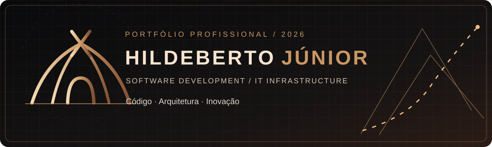

 

 

---

## ◇ 01 / Sobre mim

Sou **Hildeberto Júnior**, estudante de **Análise e Desenvolvimento de Sistemas (ADS)**, com foco em **desenvolvimento de software**, **infraestrutura de TI** e criação de soluções digitais.

Busco unir organização, boas práticas de desenvolvimento e aprendizado contínuo para construir sistemas úteis e evolutivos.

- **Desenvolvimento:** aplicações web, interfaces e lógica de sistemas
- **Infraestrutura:** ambientes Windows, servidores e ferramentas de TI
- **Processos:** automação, versionamento e melhoria contínua

> Tecnologia é o meio. Soluções são o propósito.

---

## ◇ 02 / Painel de competências técnicas

<table>
<tr><th align="left">Área</th><th align="left">Tecnologias e ferramentas utilizadas / estudadas</th><th align="left">Aplicação</th></tr>
<tr><td>🎨 Front-end</td><td>HTML · CSS · JavaScript</td><td>Interfaces web, DOM e experiências responsivas</td></tr>
<tr><td>⚙️ Back-end</td><td>Python · PHP</td><td>Lógica de aplicação, rotas e integração de sistemas</td></tr>
<tr><td>🗃️ Dados</td><td>SQL · SQLite · MySQL</td><td>Modelagem, consultas e persistência de informações</td></tr>
<tr><td>🖥️ Infraestrutura</td><td>Windows · Windows Server · PowerShell</td><td>Ambientes de desenvolvimento e administração</td></tr>
<tr><td>🧰 Fluxo de trabalho</td><td>Git · GitHub · GitLab · VS Code · Figma</td><td>Versionamento, prototipação e organização de projetos</td></tr>
</table>

Ferramentas em diferentes estágios de aprendizado e aplicação; esta lista não representa certificações ou níveis de proficiência.

---

## ◇ 03 / Projetos em destaque

> **Prévias visuais reais:** os links abaixo levam aos repositórios originais. Capturas de tela não foram adicionadas porque não foi possível validar imagens reais e atuais das interfaces; nenhuma imagem ilustrativa foi apresentada como screenshot.

<table>
<tr>
<td width="50%" valign="top">

### 🚨 [Alertê](https://github.com/hildebertosampaiojr-bot/Alertae)
Aplicação de alertas, ocorrências e emergências com navegação por mapa.

**Foco:** interface web · geolocalização · experiência do usuário

[**VER CÓDIGO ↗**](https://github.com/hildebertosampaiojr-bot/Alertae)

</td>
<td width="50%" valign="top">

### 🏋️ [Sistema de Treino](https://github.com/hildebertosampaiojr-bot/Sistema-de-Treino)
Sistema de organização e acompanhamento de treinos com experiências personalizadas.

**Foco:** interface web · organização de dados · experiência do usuário

[**VER CÓDIGO ↗**](https://github.com/hildebertosampaiojr-bot/Sistema-de-Treino)

</td>
</tr>
<tr>
<td width="50%" valign="top">

### 🌐 [Landpage-JS](https://github.com/hildebertosampaiojr-bot/Landpage-JS)
Projeto de desenvolvimento de landing page com JavaScript.

**Foco:** desenvolvimento web · interface

[**VER CÓDIGO ↗**](https://github.com/hildebertosampaiojr-bot/Landpage-JS)

</td>
<td width="50%" valign="top">

### 🧪 [Laboratório](https://github.com/hildebertosampaiojr-bot/Laboratorio)
Espaço de estudos, práticas e experimentação técnica.

**Foco:** aprendizado contínuo · prototipação

[**VER CÓDIGO ↗**](https://github.com/hildebertosampaiojr-bot/Laboratorio)

</td>
</tr>
</table>

---

## ◇ 04 / GitHub Analytics

---

## ◇ 05 / Vamos conectar?

**Aberto a compartilhar conhecimento, colaborar e construir soluções digitais.**

  

HILDEBERTO JÚNIOR · SOFTWARE DEVELOPMENT / IT INFRASTRUCTURE · 2026

