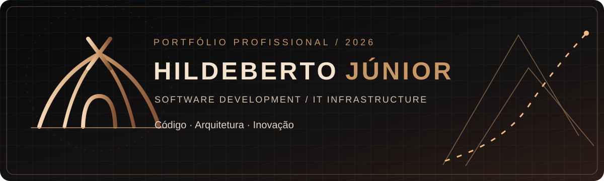

 

 

---

## ◇ 01 / Sobre mim

Sou **Hildeberto Júnior**, estudante de **Análise e Desenvolvimento de Sistemas (ADS)**, com foco em **desenvolvimento de software**, **infraestrutura de TI** e criação de soluções digitais.

Busco unir organização, boas práticas de desenvolvimento e aprendizado contínuo para construir sistemas úteis e evolutivos.

- **Desenvolvimento:** aplicações web, interfaces e lógica de sistemas
- **Infraestrutura:** ambientes Windows, servidores e ferramentas de TI
- **Processos:** automação, versionamento e melhoria contínua

> Tecnologia é o meio. Soluções são o propósito.

---

## ◇ 02 / Painel de competências técnicas

### 🎨 Front-end

  
  
  
  
  
  

### ⚙️ Back-end

  
  
  

  
  

### 🗃️ Banco de dados

  
  
  

  

### 🖥️ Infraestrutura

  
  
  
  

  

### 🚀 DevOps e versionamento

  
  
  
  

  
  
  

### 🔐 Segurança e autenticação

  
  
  
  

### 🎯 Design e experiência do usuário

  

  
  
  

### 🛠️ Ferramentas e documentação

  
  
  
  

  
  
  

### ◇ Competências complementares

| Área | Conhecimentos e práticas |
| --- | --- |
| 🏗️ **Engenharia de software** | Arquitetura de sistemas, Clean Code e refatoração. |
| 🌐 **Desenvolvimento web** | Responsividade, DOM, Canvas, acessibilidade e validação de formulários. |
| 🗃️ **Banco de dados** | Modelagem relacional, normalização e migrations. |
| 🔗 **Integrações** | APIs REST, serviços mock e integração entre sistemas. |
| 🔐 **Segurança** | Autenticação, autorização, perfis de acesso e fundamentos de LGPD. |
| 🚀 **DevOps** | Pipelines, CI/CD e acompanhamento de deploy. |
| 🤖 **Inteligência artificial** | Desenvolvimento assistido por IA, agentes e MCP. |
| 📚 **Documentação** | Diagramas, requisitos, padrões técnicos e documentação de sistemas. |

Competências, ferramentas e conhecimentos utilizados, praticados ou em estudo, em constante evolução. A presença de uma tecnologia não representa certificação ou nível de proficiência.

---

## ◇ 03 / Projetos em destaque

<table>
<tr>
<td width="50%" valign="top">

### 🚨 [Alertê](https://github.com/hildebertosampaiojr-bot/Alertae)
Aplicação de alertas, ocorrências e emergências com navegação por mapa.

**Foco:** interface web · geolocalização · experiência do usuário

[**VER CÓDIGO ↗**](https://github.com/hildebertosampaiojr-bot/Alertae)

</td>
<td width="50%" valign="top">

### 🏋️ [Sistema de Treino](https://github.com/hildebertosampaiojr-bot/Sistema-de-Treino)
Sistema de organização e acompanhamento de treinos com experiências personalizadas.

**Foco:** interface web · organização de dados · experiência do usuário

[**VER CÓDIGO ↗**](https://github.com/hildebertosampaiojr-bot/Sistema-de-Treino)

</td>
</tr>
<tr>
<td width="50%" valign="top">

### 🌐 [Landpage-JS](https://github.com/hildebertosampaiojr-bot/Landpage-JS)
Projeto de desenvolvimento de landing page com JavaScript.

**Foco:** desenvolvimento web · interface

[**VER CÓDIGO ↗**](https://github.com/hildebertosampaiojr-bot/Landpage-JS)

</td>
<td width="50%" valign="top">

### 🧪 [Laboratório](https://github.com/hildebertosampaiojr-bot/Laboratorio)
Espaço de estudos, práticas e experimentação técnica.

**Foco:** aprendizado contínuo · prototipação

[**VER CÓDIGO ↗**](https://github.com/hildebertosampaiojr-bot/Laboratorio)

</td>
</tr>
<tr>
<td width="50%" valign="top">

### ☕ [Oro Café](https://github.com/hildebertosampaiojr-bot/Cafeteria---Trabalho-javascript)
Cafeteria digital com cardápio interativo, sacola, acompanhamento de pedidos e jogos personalizados.

**Foco:** JavaScript · manipulação do DOM · Canvas · experiência do usuário

[**VER CÓDIGO ↗**](https://github.com/hildebertosampaiojr-bot/Cafeteria---Trabalho-javascript) · [**ACESSAR SITE ↗**](https://hildebertosampaiojr-bot.github.io/Cafeteria---Trabalho-javascript/)

</td>
<td width="50%" valign="top">

### 💡 [Lâmpada Funcional](https://github.com/hildebertosampaiojr-bot/Lampada-Funcional)
Simulador de interruptor que alterna a iluminação e a aparência da página em tempo real.

**Foco:** JavaScript · lógica condicional · eventos · manipulação do DOM

[**VER CÓDIGO ↗**](https://github.com/hildebertosampaiojr-bot/Lampada-Funcional) · [**ACESSAR SITE ↗**](https://hildebertosampaiojr-bot.github.io/Lampada-Funcional/)

</td>
</tr>
</table>

---

## ◇ 04 / GitHub Analytics

---

## ◇ 05 / Vamos conectar?

**Aberto a compartilhar conhecimento, colaborar e construir soluções digitais.**

  

HILDEBERTO JÚNIOR · SOFTWARE DEVELOPMENT / IT INFRASTRUCTURE · 2026

